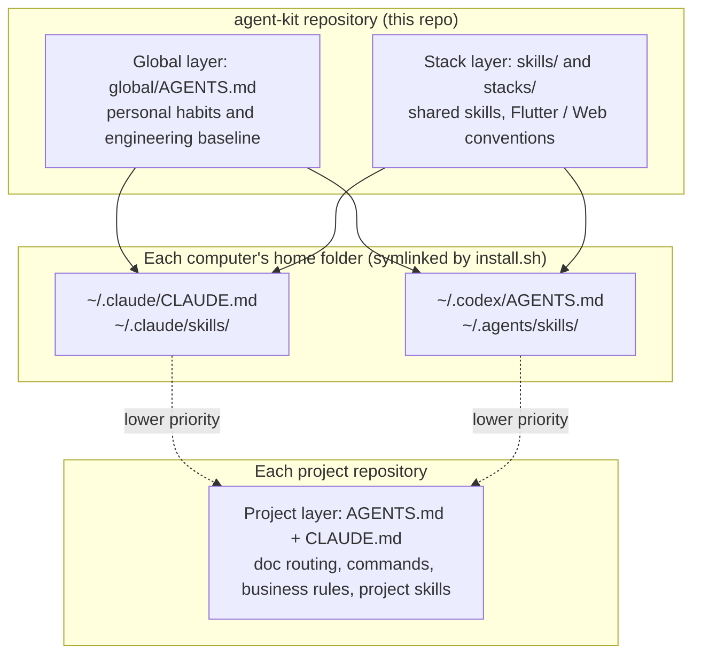

# agent-kit

[简体中文](README.md) | English

My rules and skills for AI coding assistants (Claude Code and Codex): **consistent everywhere, adapted per project**.

On a new computer, clone this repository and run the installer once — every project then uses the same rules and skills. Change a rule here in one place and every computer and every project picks it up.

> The rules, skills, terminal output and conflict-resolution page are written in Simplified Chinese, because that is the language I work in. This document explains everything in English.

---

## Contents

- [The problem it solves](#the-problem-it-solves)
- [Three layers](#three-layers)
- [What's included](#whats-included)
- [Prerequisites](#prerequisites)
- [Quick start](#quick-start)
- [Installation in detail](#installation-in-detail)
- [Handling existing content and conflicts](#handling-existing-content-and-conflicts)
- [Everyday use](#everyday-use)
- [Using it in projects](#using-it-in-projects)
- [Command reference](#command-reference)
- [Machine config file](#machine-config-file)
- [Repository layout](#repository-layout)
- [Path conventions and safety](#path-conventions-and-safety)
- [Backups, restoring and uninstalling](#backups-restoring-and-uninstalling)
- [FAQ](#faq)
- [License](#license)

---

## The problem it solves

When you use both Claude Code and Codex, across several computers and projects, rule files (`CLAUDE.md`, `AGENTS.md`) and skills (`SKILL.md`) tend to go wrong in the same ways:

- **Every project keeps its own copy**, so improving the rules in one project leaves the others on the old version.
- **The two tools read different files**: Claude Code reads `CLAUDE.md`, Codex reads `AGENTS.md`. Write in one and the other never sees it.
- **Machine-specific paths get hard-coded**, and break on the next computer.
- **Old and new skills share a name or overlap in purpose**, so the tool can't tell which one to use.

agent-kit keeps the shared rules and skills in this one repository and symlinks them into the user-level folders each tool reads. Each project keeps only what is specific to it.

## Three layers



| Layer | Contents | Where it lives |
|---|---|---|
| Global | Personal habits: Chinese as working language, plan before building, priority of information, doc conventions, verification and reporting, Git and safety baseline | `global/` in this repo |
| Stack | Shared skills, plus development conventions per tech stack | `skills/` and `stacks/` in this repo |
| Project | Doc routing, project commands, business rules, project-specific skills | Each project's own repository |

**Priority**: explicit instructions in the current task > project layer > global layer. This repository holds only the first two layers and no business rules of any specific project.

## What's included

### Global rules — `global/AGENTS.md`

Conventions that apply to every project, including:

- **Reply language**: always reply in Simplified Chinese (code, commands, paths and proper nouns stay as they are).
- **About me**: solo developer; no design training (so the assistant proposes UI options first and lets me choose); Simplified Chinese by default.
- **Plan first, then build**: a new idea goes through `idea-to-plan` into a complete plan, one stage at a time.
- **Priority of information and decisions**: explicit request > confirmed requirements > behaviour proven by code and tests > technical notes > the assistant's inferences. Always distinguish “current implementation”, “target requirement”, “proposal” and “unconfirmed assumption”.
- **Default workflow**: check the current state, define scope and done-criteria, pick the smallest complete change, touch only what's needed, verify by risk, report honestly.
- **Doc conventions, engineering baseline, verification and reporting, Git and safety.**

### Shared skills — `skills/`

| Skill | When to use it |
|---|---|
| `idea-to-plan` | You have a new idea: refine it step by step into an idea brief → PRD → prototype → technical design → development plan, then wire it into a project |
| `product-change` | Designing or changing requirements, scope, business rules, acceptance criteria |
| `ui-experience` | Designing or reviewing screens, interactions, states, responsiveness, accessibility |
| `architecture-change` | Cross-module architecture, databases and file formats, integrations, security boundaries |
| `change-review` | Code review and delivery checks (reports only, doesn't edit by default) |
| `quality-testing` | Test strategy, regression tests and quality evidence |

### Stack skills — `stacks/`

| Skill | When to use it |
|---|---|
| `flutter/skills/flutter-development` | Implementing, fixing and refactoring Flutter/Dart (FVM, Riverpod layering, localisation, verification order) |
| `web/skills/single-file-web` | Single-file web pages that open directly in a browser, with no build tools |

You can choose which stacks to install.

### Project template — `templates/project/`

| File | Purpose |
|---|---|
| `AGENTS.md` | Project entry point: summary, doc routing, project skills, project commands |
| `CLAUDE.md` | A single line, `@AGENTS.md`, so Claude Code and Codex read the same rules |
| `docs/AI_RULES.md` | Project-specific rules: current stage, scope, constraints, core invariants, testing requirements |

### Scripts — `scripts/`

| Script | Purpose |
|---|---|
| `install.sh` | Install or update for Claude Code and Codex; checks for conflicts first |
| `configure.sh` | Answer a few questions in the terminal to create the machine config |
| `new-project.sh` | Put the template files into a project |
| `check-projects.sh` | Check whether projects follow the project-layer conventions (report only) |
| `lib/review_ui.py` | The conflict-resolution web page (launched by `install.sh`) |

## Prerequisites

| Requirement | Used for | Notes |
|---|---|---|
| macOS or Linux | Running the scripts | Compatible with the bash 3.2 that ships with macOS |
| `git` | Cloning and syncing | Included with the Xcode Command Line Tools on macOS |
| GitHub CLI `gh` | Signing in to GitHub, cloning the private repo | If missing: `brew install gh` |
| `python3` (optional) | The conflict-resolution page | Included with the Xcode Command Line Tools on macOS; without it, conflicts are handled in the terminal |
| A browser | Opening the conflict-resolution page | Any modern browser |

> GitHub no longer accepts account passwords for cloning. If the terminal asks for a username and password while cloning, press `Ctrl + C` and sign in with `gh` first (step 1 of the quick start).

## Quick start

On a new computer, open Terminal and run:

**1. Sign in to GitHub (once per computer)**

```sh
command -v gh >/dev/null || brew install gh
gh auth status >/dev/null 2>&1 || gh auth login --hostname github.com --git-protocol https --web
gh auth setup-git
```

`gh auth login` shows an 8-character one-time code. Press Enter to open the browser, enter the code and authorise. `gh auth setup-git` makes `git` use the same sign-in from then on.

**2. Clone and install**

```sh
gh repo clone YuY-QK/agent-kit ~/Work/agent-kit   # any location works
cd ~/Work/agent-kit
./scripts/install.sh --dry-run                    # optional: preview the plan without changing anything
./scripts/install.sh
```

**3. Answer three questions** (asked only the first time — see [Installation in detail](#installation-in-detail)), and you're done.

**4. Check your existing projects**

```sh
./scripts/check-projects.sh
```

## Installation in detail

### First run: machine config

The first time you run `install.sh` on a computer without a machine config, it asks three questions in the terminal (shown here in English; the prompts themselves are in Chinese):

```text
== agent-kit machine config
Config file: ~/.config/agent-kit/config.sh

1. Folders that hold your projects
   The check script treats every subfolder of these folders as a project.
   Enter one folder at a time (drag a folder into Terminal, or press Tab to complete); press Enter on an empty line when done.
   Folder 1: ~/Work/Projects
   Added: ~/Work/Projects
   Folder 2:

2. Which tools to install for (choices: claude codex, separated by spaces)
   Press Enter for [claude codex]:

3. Which stack skills to install (choices: flutter web, separated by spaces)
   Press Enter for [flutter web]:

Saved to ~/.config/agent-kit/config.sh:
   PROJECT_DIRS="$HOME/Work/Projects"
   AGENT_TOOLS="claude codex"
   STACKS="flutter web"
```

When entering project folders:

- You can drag a folder from Finder into Terminal, or press Tab to complete; `~` is expanded for you.
- You can add several folders, one per line; an empty line finishes the list.
- If a folder doesn't exist you're asked whether to use it anyway; duplicates are skipped; the path must be absolute.
- You can also leave it empty the first time (press Enter and confirm skipping) and add folders later with `./scripts/configure.sh`.

The repository contains **no default project folder**. Each computer fills in its own, independently.

### The install plan

Before every install the script checks the target locations and prints a plan as a table (translated here; the real output is in Chinese):

```text
agent-kit location: ~/Work/agent-kit
Tools: claude codex    Stacks: flutter web    Mode: link

Plan: new 15  update 0  up to date 0  conflicts 3  other-source skills 2

  No.  Tool    Name                     Status        Location
  ---- ------- ------------------------ ------------- ------------------------------
  1    claude  CLAUDE.md                conflict      ~/.claude/CLAUDE.md
  5    claude  product-change           conflict      ~/.claude/skills/product-change
  10   claude  prd-writer               other source  ~/.claude/skills/prd-writer
  11   codex   AGENTS.md                conflict      ~/.codex/AGENTS.md
  20   codex   old-reviewer             other source  ~/.agents/skills/old-reviewer
```

| Status | Meaning | What happens |
|---|---|---|
| New | Nothing at the target yet | Installed directly |
| Update | Installed by agent-kit before, identical content, or an empty file | Replaced with the latest |
| Up to date | Already points at this repository | Left alone |
| **Conflict** | Something **not installed by agent-kit** already sits at the same location | You decide — see [the next section](#handling-existing-content-and-conflicts) |
| **Other source** | A differently named skill not installed by agent-kit, which may overlap with a shared skill | Kept by default; you can disable it |

Only conflicts and other-source skills are listed as rows; everything else is summarised as counts.

### Where things are installed

| Tool | Global rules | Skills |
|---|---|---|
| Claude Code | `~/.claude/CLAUDE.md` | `~/.claude/skills/<skill-name>/` |
| Codex | `~/.codex/AGENTS.md` | `~/.agents/skills/<skill-name>/` |

Both tools' global rules point at the same file, `global/AGENTS.md`.

### Symlink vs copy

- **Symlinks by default**: installed files point at the originals in the repository, so edits take effect immediately and `git pull` updates them at once.
- If a tool doesn't follow symlinks, use `./scripts/install.sh --copy`. In copy mode you need to re-run the installer after every repository update.
- You can switch between the two at any time; the script recognises what it installed earlier and replaces it without treating it as a conflict.

## Handling existing content and conflicts

If one of the target locations already holds your own file (an older `~/.claude/CLAUDE.md`, or an old skill with the same name), that's a conflict. The script **never overwrites it silently** — you decide what happens.

### In the web page (default)

When there are conflicts, the script opens a local web page in your browser. The terminal also prints the address — if the browser doesn't open, paste it in. Resolution works like resolving a git conflict:

- **Left** = what you had (current)
- **Right** = agent-kit's version (incoming)


Each row of the **conflict table** shows the tool, name, location, diff stats (lines removed and added, number of differences), status, and an **actions column**:

| Action | Effect |
|---|---|
| **Accept left** | Keep your file; agent-kit's version is not installed at this location |
| **Accept right** | Move your file to the backup folder, then install agent-kit's version |
| **Merge block by block** | Open a side-by-side comparison and resolve each difference separately; the result is written back into the agent-kit repository and then installed |
| View diff | Just look, without choosing |

### Block-by-block merge


Both files are split into identical sections and a number of difference blocks. Identical sections are folded (click to expand), and the exact characters that differ within a line are highlighted. Every difference block offers:

| Action | What goes into the result |
|---|---|
| **Accept left** | Only your version of this block |
| **Accept right** | Only agent-kit's version of this block |
| **Both · left first** | Yours first, then agent-kit's |
| **Both · right first** | agent-kit's first, then yours |
| **Neither** | Drop this block from both sides |
| **Edit…** | Write this block's content by hand |
| Undo | Back to unresolved |

After you resolve a block, the page jumps to the next unresolved one. The toolbar at the top also has:

| Toolbar button | Purpose |
|---|---|
| Previous / next unresolved | Jump between unresolved blocks |
| Accept left / right for all remaining | Resolve every remaining block at once |
| Reset | Return every block in this file to unresolved |
| Edit result directly | Stop choosing block by block and edit the final text freely; “discard manual edits” returns to block mode |
| Use …'s merge result | Claude Code's and Codex's global rules share one file; after merging one, click this on the other to keep them identical |

### Merge result preview


The preview below shows the final text live. **Unresolved blocks** are marked with git-style conflict markers:

```text
<<<<<<< 你原来的   (yours)
(left content)
=======
(right content)
>>>>>>> agent-kit
```

The **Apply** button at the bottom becomes available only when every conflict is resolved — each file set to accept left, accept right, or fully merged. If you edited the result directly and left conflict markers in it, the first click on Apply warns you; click again to submit anyway.

> The merge result is **written back into the agent-kit repository** (for example `global/AGENTS.md`). When the install finishes, the terminal reminds you to commit and push so that other computers get it with `git pull`.
>
> A skill is a folder; block-by-block merge covers only its `SKILL.md`. Choosing “accept right” replaces the whole folder, and the original folder is backed up in full.

### Other-source skills


These skills weren't installed by agent-kit and have different names, but may overlap with a shared skill so that both get triggered. Click “view content” and then choose **keep** (default) or **disable** (moved to the backup folder so the tool no longer loads it).

### Narrow screens and dark mode

The page follows your system's light/dark setting, with a manual toggle at the top right. On narrow screens the tables turn into cards.


### Apply, cancel and timeout

- **Apply**: go back to the terminal to see the install result.
- **Cancel**, or `Ctrl + C` in the terminal: nothing is changed.
- If nothing is submitted within 30 minutes, it is treated as cancelled.

### In the terminal

With `--no-web`, or when no usable `python3` is available, the script asks about each conflict in the terminal (translated):

```text
[1] claude's global rules already exist: ~/.claude/CLAUDE.md
  r = replace (back up the old one)  k = keep mine  d = show diff :
```

Terminal mode offers only whole-file replace or keep; use the web page for block-by-block merging.

### Without prompts

| Situation | What happens to conflicts |
|---|---|
| `--yes` | Always back up, then replace |
| Non-interactive (e.g. called from another script) without `--yes` | Always keep the existing content, and say so in the output |

## Everyday use

### Syncing updates

On any computer:

```sh
cd ~/Work/agent-kit
git pull
./scripts/install.sh
```

With symlinks, existing rules and skills are current as soon as `git pull` finishes. **When skills were added, removed or renamed**, run `install.sh` again to link new skills and clean up stale links. Running it after every pull is the simplest habit; anything already up to date is left untouched.

### Changing a rule or skill

1. Edit the file in the repository, e.g. `global/AGENTS.md` or `skills/idea-to-plan/SKILL.md`. With symlinks, the change takes effect immediately.
2. Commit and push:

   ```sh
   cd ~/Work/agent-kit
   git add -A
   git commit -m "docs: adjust global rules"
   git push
   ```

3. Other computers just `git pull`.

### Adding a skill

1. Create `skills/<skill-name>/SKILL.md` (or `stacks/<stack>/skills/<skill-name>/SKILL.md` for a stack-specific one), starting with `name` and `description`:

   ```markdown
   ---
   name: my-skill
   description: What this skill does and when it should be used.
   ---

   # Body: how to do it
   ```

   The folder name must match `name`. Make `description` clear about *when* to use the skill — that's what the tools rely on to decide whether to call it.
2. Run `./scripts/install.sh` to install it.
3. Commit and push.

### Changing the machine config

```sh
./scripts/configure.sh               # answer the questions again; Enter keeps the current value
./scripts/install.sh --configure     # answer, then reinstall
```

### Skills in the Claude app

Skills saved in the Claude app or on claude.ai live in your Claude account. They are separate from this repository, and the Claude Code CLI and Codex can't see them. **Treat this repository as the source of truth**, and update the account copy when you change a skill.

## Using it in projects

### New projects

```sh
./scripts/new-project.sh ~/Work/Projects/my-app           # project name defaults to the folder name
./scripts/new-project.sh ~/Work/Projects/my-app "My App"  # explicit project name
```

This adds `AGENTS.md`, `CLAUDE.md` and `docs/AI_RULES.md`; existing files are never overwritten. Then fill in the parts marked `{{...}}` in `AGENTS.md` and `docs/AI_RULES.md`.

### Each project keeps only the project layer

| Content | Where |
|---|---|
| Doc routing, list of project skills, project commands | `AGENTS.md` at the project root |
| Letting Claude Code read the same rules | `CLAUDE.md` at the project root, containing only `@AGENTS.md` |
| Requirements, prototype, technical design, development plan, project rules | Authoritative docs under `docs/` (`PRD_v1.0.md`, `AI_RULES.md`, …) |
| Skills unique to this project | Codex: `.agents/skills/`; Claude Code: `.claude/skills/` |

> **Don't give project skills the same name as a shared skill.** Both copies would show up and the tool can't tell which to use. Put project-specific rules in `docs/AI_RULES.md`, or create a project skill under a different name.

### Checking projects

```sh
./scripts/check-projects.sh                         # every project under the folders in your machine config
./scripts/check-projects.sh ~/Work/Projects/my-app  # only the given project(s)
```

```text
✓ new-app
✗ my-app
  - 缺少 CLAUDE.md（Claude Code 读不到 AGENTS.md）   (missing CLAUDE.md — Claude Code can't see AGENTS.md)
  - .agents/skills/product-change 与通用技能同名      (same name as a shared skill)
```

It checks whether `AGENTS.md` exists; whether `CLAUDE.md` exists and references `@AGENTS.md`; and whether the project holds copies of shared skills under the same name. It only reports and never changes files. A subfolder counts as a project if it contains `.git`, `AGENTS.md` or `CLAUDE.md`.

### Migrating an existing project to the project layer

1. Run `check-projects.sh` to see which projects need attention.
2. For project skills named like a shared skill: move the project-specific rules into `docs/AI_RULES.md` (or into a differently named project skill), then delete the duplicate.
3. Add `CLAUDE.md` containing `@AGENTS.md`.
4. Trim `AGENTS.md` down to doc routing, project skills and project commands; leave the shared parts to the global rules.
5. Run `check-projects.sh` again — when everything shows ✓, you're done.

## Command reference

### `scripts/install.sh`

| Option | Effect |
|---|---|
| (none) | Install or update (symlinks); open the web page if there are conflicts |
| `--dry-run` | Only print the install plan; change nothing and ask nothing |
| `--review` | Open the web page even without conflicts, to review other-source skills |
| `--no-web` | Don't open the web page; resolve conflicts one by one in the terminal |
| `--yes`, `-y` | Don't ask; always back up and replace conflicts |
| `--copy` | Copy files instead of symlinking |
| `--configure` | Answer the machine-config questions again, then install |
| `--uninstall` | Remove what agent-kit installed (other content and backups are untouched) |
| `-h`, `--help` | Show help |

### Other scripts

| Command | Effect |
|---|---|
| `scripts/configure.sh` | Recreate the machine config; Enter keeps the current value |
| `scripts/new-project.sh <project-folder> [project-name]` | Add the template to a project without overwriting existing files |
| `scripts/check-projects.sh [project-folder...]` | Check projects; with no arguments, every project under `PROJECT_DIRS` |

### Environment variables (rarely needed)

| Variable | Effect |
|---|---|
| `AGENT_KIT_CONFIG` | Use a machine config file at another location |
| `AGENT_KIT_NO_BROWSER=1` | Don't open the browser automatically; only print the page address |
| `PAGER` | Pager used to show diffs in terminal mode; defaults to `less` |

## Machine config file

Location: `~/.config/agent-kit/config.sh`. Created by `configure.sh`, belongs to this computer only, never committed. Format reference: [`config.example.sh`](config.example.sh).

```sh
# Folders that hold projects, separated by colons
PROJECT_DIRS="$HOME/Work/Projects:$HOME/Code"

# Tools to install for: claude codex
AGENT_TOOLS="claude codex"

# Stack skills to install: flutter web
STACKS="flutter web"
```

| Setting | Description |
|---|---|
| `PROJECT_DIRS` | Folders that hold projects, separated by colons; paths may contain spaces. Only `check-projects.sh` uses it |
| `AGENT_TOOLS` | Tools to install for: `claude`, `codex`, separated by spaces |
| `STACKS` | Stack skills to install: `flutter`, `web`, separated by spaces |

## Repository layout

```text
agent-kit/
├── global/
│   └── AGENTS.md                 # global rules
├── skills/                       # shared skills, one folder each
│   ├── idea-to-plan/SKILL.md
│   ├── product-change/SKILL.md
│   ├── ui-experience/SKILL.md
│   ├── architecture-change/SKILL.md
│   ├── change-review/SKILL.md
│   └── quality-testing/SKILL.md
├── stacks/                       # skills per tech stack
│   ├── flutter/skills/flutter-development/SKILL.md
│   └── web/skills/single-file-web/SKILL.md
├── templates/project/            # template for new projects
│   ├── AGENTS.md
│   ├── CLAUDE.md
│   └── docs/AI_RULES.md
├── scripts/
│   ├── install.sh                # install / update / uninstall
│   ├── configure.sh              # machine config
│   ├── new-project.sh            # add the template to a project
│   ├── check-projects.sh         # check projects
│   └── lib/review_ui.py          # conflict-resolution page
├── docs/images/                  # screenshots for the docs
├── config.example.sh             # machine-config format reference
├── README.md                     # 中文说明
├── README.en.md                  # English
└── LICENSE
```

## Path conventions and safety

**No hard-coded machine paths**

- The scripts work out where the repository is, so it can be cloned anywhere.
- The home folder is always written as `$HOME`; paths under it are stored as `$HOME/...` in the config too.
- Settings that differ between computers live only in the machine config.
- Skills and rules refer to “the project root” and `docs/`, never to absolute paths.

**Safety of the conflict-resolution page**

- It listens only on `127.0.0.1`, so other devices on your network can't reach it.
- The address carries a one-time random token that changes every run; requests without it are rejected.
- Only requests addressed to `127.0.0.1` or `localhost` are accepted.
- A merge result can only be written to the matching file inside the agent-kit repository; anything else is refused.
- It uses only the Python standard library, makes no network requests and loads no external resources.
- It shuts down after you apply or cancel, or after a 30-minute timeout.

**Nothing of yours is deleted silently**

- Replaced or disabled content is moved to a backup folder first, never deleted outright.
- In non-interactive runs, existing content is kept by default.

## Backups, restoring and uninstalling

### Where backups go

Replaced or disabled content is moved to:

```text
~/.config/agent-kit/backups/<timestamp>/
```

The folder structure mirrors the original location: for example `~/.claude/CLAUDE.md` is backed up to `~/.config/agent-kit/backups/20261022-201838/.claude/CLAUDE.md`. Backups sit outside the skill folders, so no tool mistakes them for duplicate skills.

List all backups:

```sh
ls -R ~/.config/agent-kit/backups
```

### Restoring one item

To restore your original `~/.claude/CLAUDE.md` (replace the timestamp with the real backup folder):

```sh
rm ~/.claude/CLAUDE.md    # remove the symlink agent-kit installed
mv ~/.config/agent-kit/backups/20261022-201838/.claude/CLAUDE.md ~/.claude/CLAUDE.md
```

A disabled skill is restored the same way: move its folder back. The next time you run `install.sh`, the restored item shows up as a conflict again; choose “accept left” to keep it.

### Uninstalling

```sh
./scripts/install.sh --uninstall
```

This removes only what agent-kit installed (symlinks into this repository and files installed in copy mode). Your other skills and the backups are untouched. To get your earlier content back, move it out of the backup folder as shown above.

## FAQ

**Cloning asks for a username and password?**
GitHub doesn't accept passwords for cloning. Press `Ctrl + C`, sign in with `gh` as in step 1 of the [quick start](#quick-start), then clone again.

**`brew: command not found`?**
Homebrew isn't installed. Copy the install command from [brew.sh](https://brew.sh), install it, then run the commands again.

**`~/Work/agent-kit` already exists?**
You cloned it before, or an interrupted clone left the folder behind. If it's a complete repository, `cd` into it and run `git pull`. If it was left by an interrupted clone, delete it (`rm -rf ~/Work/agent-kit`) and clone again.

**The browser didn't open?**
Copy the page address printed in the terminal into your browser. The address is valid only while that run is active.

**“No usable python3 found”?**
Conflicts are then handled in the terminal. To use the web page on macOS, install the Command Line Tools with `xcode-select --install`.

**`check-projects.sh` says a folder doesn't exist and skips it?**
The project folder in this computer's machine config doesn't match the actual one. Run `./scripts/configure.sh` and enter this computer's folder.

**My two computers keep projects in different folders.**
That's fine. Project folders are stored in each computer's own machine config and never committed.

**Why does a skill appear twice in Codex?**
A project still holds a copy of a shared skill under the same name. Find it with `check-projects.sh` and follow the [migration steps](#migrating-an-existing-project-to-the-project-layer).

**I merged in the web page, but my other computer didn't change.**
The merge result was written into the agent-kit repository on this computer. Commit and push it, then `git pull` on the other computer.

**I changed a skill in the repository, but the Claude app didn't change.**
Skills in the Claude app and on claude.ai live in your account, separately from this repository, and need to be updated there.

**A tool doesn't follow symlinks.**
Use `./scripts/install.sh --copy`. Remember to re-run the installer after every repository update.

## License

[MIT](LICENSE)
