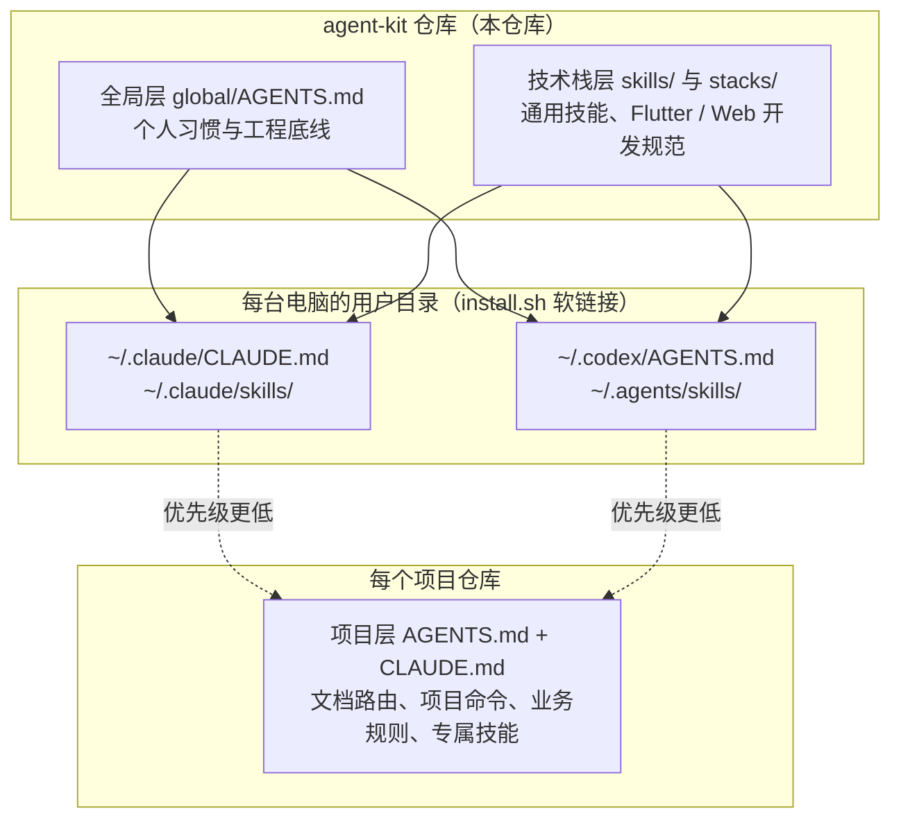
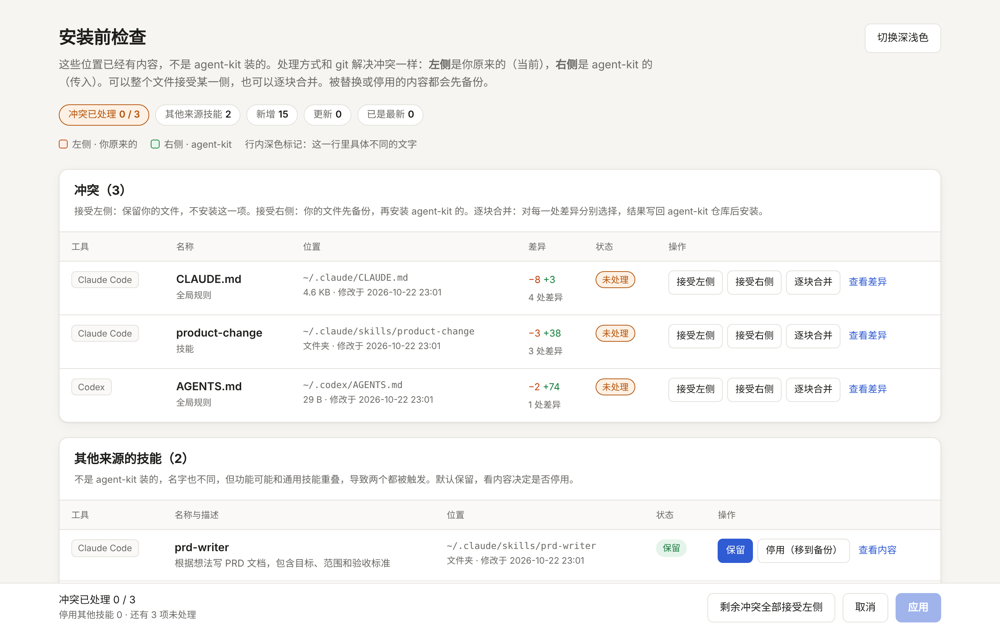
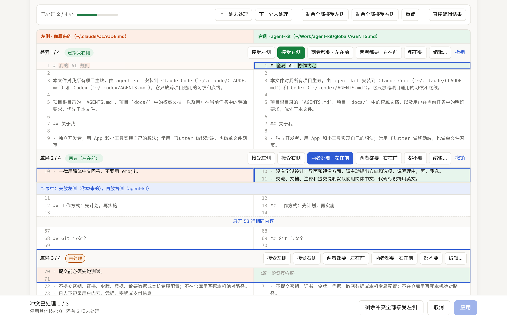
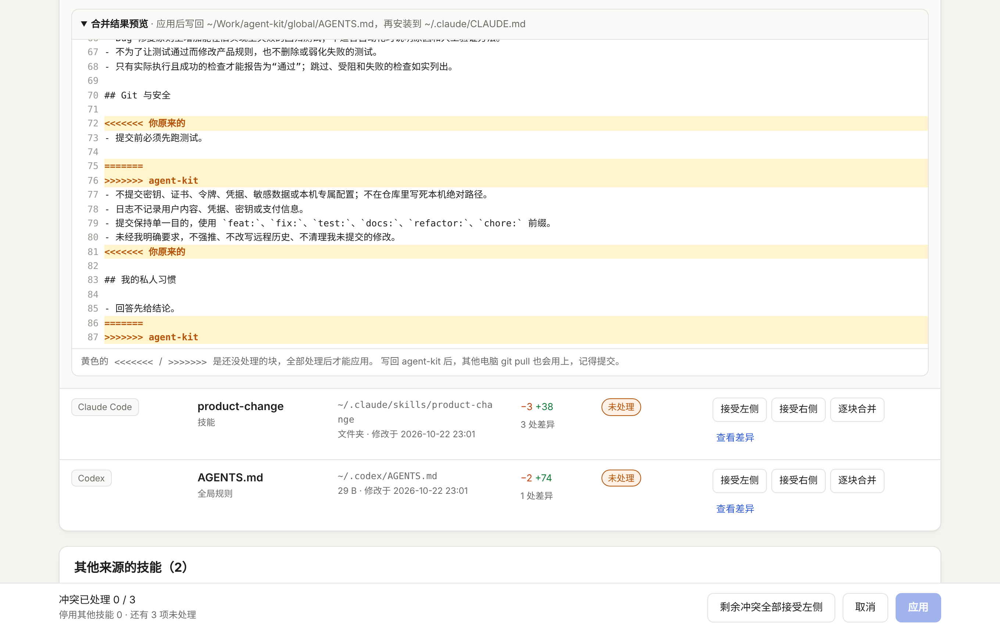
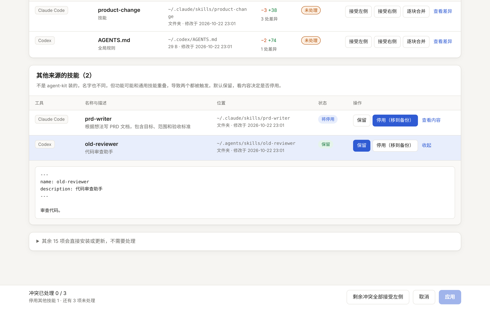
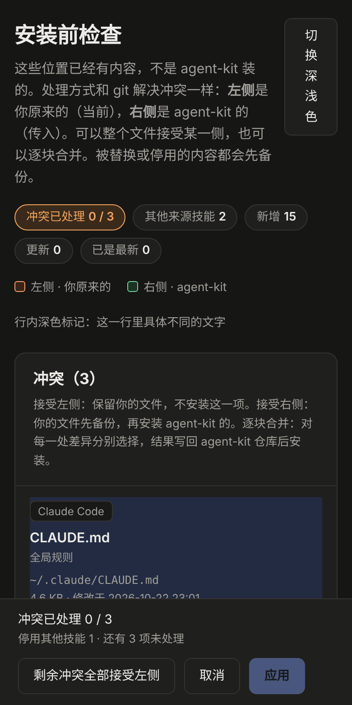

# agent-kit

简体中文 | [English](README.en.md)

我的 AI 编程助手（Claude Code、Codex）规则与技能合集：**全局统一，各项目按需适配**。

换一台电脑，克隆这个仓库，运行一次安装脚本，所有项目就能用上同一套规则和技能。规则只在这里改一处，所有电脑、所有项目一起更新。

---

## 目录

- [它解决什么问题](#它解决什么问题)
- [三层结构](#三层结构)
- [包含什么](#包含什么)
- [准备工作](#准备工作)
- [快速开始](#快速开始)
- [安装详解](#安装详解)
- [已有内容和冲突的处理](#已有内容和冲突的处理)
- [日常使用](#日常使用)
- [在项目中使用](#在项目中使用)
- [命令参考](#命令参考)
- [本机配置文件](#本机配置文件)
- [仓库目录结构](#仓库目录结构)
- [路径约定与安全](#路径约定与安全)
- [备份、恢复与卸载](#备份恢复与卸载)
- [常见问题](#常见问题)
- [许可证](#许可证)

---

## 它解决什么问题

同时用 Claude Code 和 Codex、在多台电脑上开发多个项目时，规则文件（`CLAUDE.md`、`AGENTS.md`）和技能（`SKILL.md`）很容易出现这些问题：

- **每个项目各存一份副本**，改进了一个项目的规则，其他项目还是旧版本；
- **两个工具读不同的文件**：Claude Code 读 `CLAUDE.md`，Codex 读 `AGENTS.md`，写在一边，另一边看不到；
- **项目里写死了本机路径**，换一台电脑就不对；
- **新旧技能同名或功能重叠**，工具不知道该用哪一个。

agent-kit 的做法：通用的规则和技能集中放在这个仓库，用软链接安装到各工具读取的用户级目录；每个项目只保留自己特有的内容。

## 三层结构



| 层 | 内容 | 存放位置 |
|---|---|---|
| 全局层 | 个人习惯：中文交流、先计划后实施、信息优先级、文档约定、验证与报告、Git 与安全底线 | 本仓库 `global/` |
| 技术栈层 | 通用技能，以及按技术栈区分的开发规范 | 本仓库 `skills/`、`stacks/` |
| 项目层 | 文档路由、项目命令、业务规则、项目专属技能 | 各项目自己的仓库 |

**优先级**：当前任务里的明确要求 ＞ 项目层 ＞ 全局层。本仓库只放前两层，不放任何具体项目的业务规则。

## 包含什么

### 全局规则 `global/AGENTS.md`

对所有项目生效的约定，主要包括：

- **关于我**：独立开发者、没学过设计（界面方案由 AI 先给选项再让我选）、默认简体中文；
- **先计划，再实施**：新想法先用 `idea-to-plan` 形成完整计划，一次推进一个阶段；
- **信息与决策优先级**：明确要求 ＞ 已确认需求 ＞ 代码与测试证明的现状 ＞ 技术说明 ＞ AI 推断；始终区分“当前实现”“目标要求”“建议方案”“未确认假设”；
- **默认工作流程**：先看现状、定范围和完成条件、最小完整方案、只改需要的文件、按风险验证、如实报告；
- **文档约定、工程底线、验证与报告、Git 与安全**。

### 通用技能 `skills/`

| 技能 | 什么时候用 |
|---|---|
| `idea-to-plan` | 有新想法时：逐步完善成想法简报 → PRD → 原型图 → 技术设计 → 开发计划，再接入项目 |
| `product-change` | 设计或修改需求、范围、业务规则、验收标准 |
| `ui-experience` | 设计或审查页面、交互、状态、响应式和可访问性 |
| `architecture-change` | 跨模块架构、数据库与文件格式、外部集成、安全边界 |
| `change-review` | 代码审查和交付检查（默认只报告，不修改） |
| `quality-testing` | 测试策略、回归测试和质量证据 |

### 技术栈技能 `stacks/`

| 技能 | 什么时候用 |
|---|---|
| `flutter/skills/flutter-development` | Flutter/Dart 的实现、修复和重构（含 FVM、Riverpod 分层、本地化、验证顺序） |
| `web/skills/single-file-web` | 不依赖构建工具、浏览器直接打开的单文件网页 |

安装时可以选择只装需要的技术栈。

### 项目模板 `templates/project/`

| 文件 | 作用 |
|---|---|
| `AGENTS.md` | 项目入口：项目简介、文档路由、专属技能、项目命令 |
| `CLAUDE.md` | 只有一行 `@AGENTS.md`，让 Claude Code 和 Codex 读同一份规则 |
| `docs/AI_RULES.md` | 项目特有的执行细则：当前阶段、范围、约束、核心不变量、测试要求 |

### 脚本 `scripts/`

| 脚本 | 作用 |
|---|---|
| `install.sh` | 安装或更新到 Claude Code 和 Codex；先检查冲突再安装 |
| `configure.sh` | 在命令行里回答问题，生成本机配置 |
| `new-project.sh` | 给项目放入模板文件 |
| `check-projects.sh` | 检查各项目是否符合项目层约定（只报告） |
| `lib/review_ui.py` | 冲突处理网页（由 `install.sh` 调用） |

## 准备工作

| 需要 | 用途 | 说明 |
|---|---|---|
| macOS 或 Linux | 运行脚本 | 脚本兼容 macOS 自带的 bash 3.2 |
| `git` | 克隆和同步仓库 | macOS 装了 Xcode 命令行工具即自带 |
| GitHub 命令行工具 `gh` | 登录 GitHub、克隆私有仓库 | 没有的话：`brew install gh` |
| `python3`（可选） | 冲突处理网页 | macOS 装了 Xcode 命令行工具即自带；没有时自动改为在终端里处理 |
| 浏览器 | 打开冲突处理网页 | 任意现代浏览器 |

> GitHub 早已不支持用账号密码克隆仓库。克隆时如果终端要你输入用户名和密码，按 `Ctrl + C` 退出，先用 `gh` 登录（见下方快速开始第 1 步）。

## 快速开始

在新电脑上，打开“终端”，依次执行：

**1. 登录 GitHub（每台电脑只需一次）**

```sh
command -v gh >/dev/null || brew install gh
gh auth status >/dev/null 2>&1 || gh auth login --hostname github.com --git-protocol https --web
gh auth setup-git
```

`gh auth login` 会显示一个 8 位一次性验证码，按回车后打开浏览器，输入验证码并授权即可。`gh auth setup-git` 让 `git` 以后也使用这个登录。

**2. 克隆并安装**

```sh
gh repo clone YuY-QK/agent-kit ~/Work/agent-kit   # 也可以克隆到其他位置
cd ~/Work/agent-kit
./scripts/install.sh --dry-run                    # 可选：先预演，只看计划不改文件
./scripts/install.sh
```

**3. 回答三个问题**（只有第一次会问，详见[安装详解](#安装详解)），完成。

**4. 检查已有项目**

```sh
./scripts/check-projects.sh
```

## 安装详解

### 第一次运行：本机配置

第一次运行 `install.sh` 时，如果这台电脑还没有本机配置，会在命令行里依次询问：

```text
== agent-kit 本机配置
配置文件：~/.config/agent-kit/config.sh

1. 存放项目的目录
   检查脚本会把这些目录下的每个子文件夹当作一个项目。
   每次输入一个目录（可以把文件夹拖进终端，或按 Tab 补全），全部输完后直接回车。
   目录 1：~/Work/Projects
   已添加：~/Work/Projects
   目录 2：

2. 要安装到哪些工具（可选：claude codex，用空格分隔）
   直接回车使用 [claude codex]：

3. 要安装哪些技术栈的技能（可选：flutter web，用空格分隔）
   直接回车使用 [flutter web]：

已保存到 ~/.config/agent-kit/config.sh：
   PROJECT_DIRS="$HOME/Work/Projects"
   AGENT_TOOLS="claude codex"
   STACKS="flutter web"
```

输入项目目录时：

- 可以把 Finder 里的文件夹直接拖进终端，也可以按 Tab 补全；`~` 会自动展开；
- 可以输入多个目录，每次一个，输完后直接回车结束；
- 目录不存在时会先问你是否仍然使用；重复的目录会自动跳过；必须是完整路径；
- 第一次也可以不填（回车后确认“暂不设置”），以后再运行 `./scripts/configure.sh` 补上。

仓库里**没有任何默认项目目录**，每台电脑各自填写，互不影响。

### 安装计划

每次安装前，脚本都会先检查目标位置，在终端里用表格列出计划：

```text
agent-kit 位置：~/Work/agent-kit
工具：claude codex    技术栈：flutter web    方式：link

安装计划：新增 15  更新 0  已是最新 0  冲突 3  其他来源技能 2

  编号 工具    名称                     状态     位置
  ---- ------- ------------------------ -------- ------------------------------
  1    claude  CLAUDE.md                冲突　　 ~/.claude/CLAUDE.md
  5    claude  product-change           冲突　　 ~/.claude/skills/product-change
  10   claude  prd-writer               其他来源 ~/.claude/skills/prd-writer
  11   codex   AGENTS.md                冲突　　 ~/.codex/AGENTS.md
  20   codex   old-reviewer             其他来源 ~/.agents/skills/old-reviewer
```

| 状态 | 含义 | 安装时怎么处理 |
|---|---|---|
| 新增 | 目标位置还没有内容 | 直接安装 |
| 更新 | 之前由 agent-kit 装过，或内容完全相同，或是空文件 | 直接替换为最新 |
| 已是最新 | 已经正确指向本仓库 | 不动 |
| **冲突** | 同一位置已有**不是 agent-kit 装的**内容 | 由你决定，见[下一节](#已有内容和冲突的处理) |
| **其他来源** | 技能目录里有名字不同、不是 agent-kit 装的技能，可能和通用技能功能重叠 | 默认保留，可以选择停用 |

表格里只列出冲突和其他来源，其余的只显示数量。

### 安装到哪里

| 工具 | 全局规则 | 技能 |
|---|---|---|
| Claude Code | `~/.claude/CLAUDE.md` | `~/.claude/skills/<技能名>/` |
| Codex | `~/.codex/AGENTS.md` | `~/.agents/skills/<技能名>/` |

两个工具的全局规则都指向同一个文件 `global/AGENTS.md`。

### 软链接和复制

- **默认用软链接**：安装后的文件指向仓库里的原文件，在仓库里改了马上生效，`git pull` 后也立即更新；
- 某个工具不认软链接时，用 `./scripts/install.sh --copy` 改为复制。复制模式下，每次仓库更新后都要重新运行安装；
- 两种方式可以随时互相切换，脚本会识别之前装的内容并替换，不会当成冲突。

## 已有内容和冲突的处理

如果某个位置已经有你自己的文件（比如以前写的 `~/.claude/CLAUDE.md`，或同名的旧技能），这就是冲突。脚本**不会直接覆盖**，会让你决定怎么处理。

### 在网页里处理（默认）

有冲突时，脚本会在浏览器里打开一个本地网页。终端会显示网页地址；浏览器没有自动打开时，复制地址到浏览器即可。处理方式和 git 解决冲突一样：

- **左侧** = 你原来的（当前）
- **右侧** = agent-kit 的（传入）



**冲突表格**每一行显示工具、名称、位置、差异统计（删除和新增的行数、有几处差异）、处理状态，以及**操作列**：

| 操作 | 效果 |
|---|---|
| **接受左侧** | 保留你原来的文件，这个位置不安装 agent-kit 的版本 |
| **接受右侧** | 原来的文件先移到备份，再安装 agent-kit 的版本 |
| **逐块合并** | 展开左右并排的对比，对每一处差异分别处理；结果写回 agent-kit 仓库，再安装 |
| 查看差异 | 只看对比，不做选择 |

### 逐块合并



两份文件会被拆成“相同的部分”和若干“差异块”。相同的部分自动折叠（可以点开），同一行里具体不同的文字会用深色标出。每一个差异块都有这些操作：

| 操作 | 结果里放什么 |
|---|---|
| **接受左侧** | 只用你原来的这一块 |
| **接受右侧** | 只用 agent-kit 的这一块 |
| **两者都要 · 左在前** | 先放你原来的，再放 agent-kit 的 |
| **两者都要 · 右在前** | 先放 agent-kit 的，再放你原来的 |
| **都不要** | 这一块两边都删掉 |
| **编辑…** | 手动写这一块的内容 |
| 撤销 | 回到“未处理” |

处理完一块，页面会自动跳到下一块还没处理的。顶部工具栏还有：

| 工具栏按钮 | 作用 |
|---|---|
| 上一处未处理 / 下一处未处理 | 在还没处理的块之间跳转 |
| 剩余全部接受左侧 / 右侧 | 把还没处理的块一次性处理掉 |
| 重置 | 这个文件的所有块回到未处理 |
| 直接编辑结果 | 不再逐块选择，直接自由编辑最终内容；“放弃手动修改”可以回到逐块处理 |
| 套用 … 的合并结果 | Claude Code 和 Codex 的全局规则共用同一个文件，合并好一个后，另一个点这里保持一致 |

### 合并结果预览



下方的预览实时显示最终内容。**还没处理的块**像 git 一样用冲突标记标出：

```text
<<<<<<< 你原来的
（左侧内容）
=======
（右侧内容）
>>>>>>> agent-kit
```

所有冲突都处理完（每个文件都选了接受左侧、接受右侧，或逐块全部处理完），底部的“应用”按钮才能点。如果在“直接编辑结果”里还留着冲突标记，第一次点“应用”会先提醒，再点一次才会提交。

> 合并结果会**写回 agent-kit 仓库**里的对应文件（例如 `global/AGENTS.md`）。安装结束时，终端会提醒你提交并推送，这样其他电脑 `git pull` 后也能用上。
>
> 技能是一个文件夹，逐块合并只处理其中的 `SKILL.md`。选“接受右侧”时整个文件夹都会被替换，原来的文件夹完整备份。

### 其他来源的技能



这些技能不是 agent-kit 装的，名字也不同，但可能和通用技能功能重叠，导致两个都被触发。可以先点“查看内容”，再选择**保留**（默认）或**停用**（移到备份目录，工具就不会再加载）。

### 窄屏和深色模式

网页跟随系统的深浅色，也可以点右上角手动切换；窄屏时表格自动变成卡片。



### 应用、取消和超时

- 点 **应用**：回到终端查看安装结果；
- 点 **取消**，或在终端按 `Ctrl + C`：什么都不改；
- 网页 30 分钟没有提交，按取消处理。

### 在终端里处理

加 `--no-web`，或者电脑上没有可用的 `python3` 时，会在终端里逐个询问：

```text
[1] claude 的 全局规则 已存在：~/.claude/CLAUDE.md
  r = 替换（先备份旧的）  k = 保留我原来的  d = 查看差异 ：
```

终端模式只有整文件的替换和保留；需要逐块合并时，请使用网页。

### 不询问

| 情况 | 冲突怎么处理 |
|---|---|
| 加 `--yes` | 一律先备份再替换 |
| 非交互环境（例如在其他脚本里调用）且没加 `--yes` | 一律保留原内容，并在输出里说明 |

## 日常使用

### 同步更新

在任何一台电脑上：

```sh
cd ~/Work/agent-kit
git pull
./scripts/install.sh
```

软链接模式下，`git pull` 之后已有的规则和技能立即是新的。**仓库里新增、删除或改名了技能时**，需要再运行一次 `install.sh`，才会装上新技能、清掉失效的链接。每次 pull 之后都运行一次最省心，已经是最新的项目不会被改动。

### 修改规则或技能

1. 直接编辑仓库里的文件，例如 `global/AGENTS.md` 或 `skills/idea-to-plan/SKILL.md`；软链接模式下立即生效；
2. 提交并推送：

   ```sh
   cd ~/Work/agent-kit
   git add -A
   git commit -m "docs: 调整全局规则"
   git push
   ```

3. 其他电脑 `git pull` 即可。

### 新增一个技能

1. 新建 `skills/<技能名>/SKILL.md`（某个技术栈专用的放在 `stacks/<技术栈>/skills/<技能名>/SKILL.md`）。文件开头写上 `name` 和 `description`：

   ```markdown
   ---
   name: my-skill
   description: 这个技能做什么、什么时候该用它。
   ---

   # 正文：具体怎么做
   ```

   目录名要和 `name` 一致，`description` 写清楚“什么时候用”，工具靠它决定是否调用。
2. 运行 `./scripts/install.sh` 装上；
3. 提交并推送。

### 修改本机配置

```sh
./scripts/configure.sh               # 重新回答问题，直接回车保留当前值
./scripts/install.sh --configure     # 回答完顺便重新安装
```

### Claude App 里的技能

在 Claude App 或网页版里保存的技能，存在你的 Claude 账号中，和这里是两套，Claude Code 命令行和 Codex 读不到。**以本仓库为准**，修改技能后，顺手更新账号里的那一份。

## 在项目中使用

### 新项目

```sh
./scripts/new-project.sh ~/Work/Projects/my-app            # 项目名默认取目录名
./scripts/new-project.sh ~/Work/Projects/my-app "我的应用"  # 指定项目名
```

会放入 `AGENTS.md`、`CLAUDE.md`、`docs/AI_RULES.md` 三个文件，已存在的文件不会被覆盖。之后填写 `AGENTS.md` 和 `docs/AI_RULES.md` 里 `{{...}}` 标出的部分。

### 每个项目只保留项目层的内容

| 内容 | 放在哪里 |
|---|---|
| 文档路由、专属技能列表、项目命令 | 项目根目录 `AGENTS.md` |
| 让 Claude Code 读到同一份规则 | 项目根目录 `CLAUDE.md`，只有一行 `@AGENTS.md` |
| 需求、原型、技术设计、开发计划、项目规则 | `docs/` 下的权威文档（`PRD_v1.0.md`、`AI_RULES.md` 等） |
| 本项目独有的技能 | Codex：`.agents/skills/`；Claude Code：`.claude/skills/` |

> **项目里的技能不要和通用技能同名。** 同名时两份都会出现，工具不知道该用哪一份。项目特有的规则写进 `docs/AI_RULES.md`，或者用不同的名字建一个项目专属技能。

### 检查项目

```sh
./scripts/check-projects.sh                         # 检查本机配置里所有项目目录下的项目
./scripts/check-projects.sh ~/Work/Projects/my-app  # 只检查指定项目
```

```text
✓ new-app
✗ my-app
  - 缺少 CLAUDE.md（Claude Code 读不到 AGENTS.md）
  - .agents/skills/product-change 与通用技能同名
```

会检查：有没有 `AGENTS.md`；有没有 `CLAUDE.md`，以及它是否引用了 `@AGENTS.md`；项目里有没有和通用技能同名的副本。脚本只报告，不修改任何文件。项目目录下含有 `.git`、`AGENTS.md` 或 `CLAUDE.md` 的子文件夹，才会被当作项目。

### 把已有项目迁移到项目层

1. 运行 `check-projects.sh`，看看哪些项目要处理；
2. 项目里和通用技能同名的技能：其中项目特有的规则移到 `docs/AI_RULES.md`（或改名成项目专属技能），然后删掉同名副本；
3. 补上 `CLAUDE.md`（内容为 `@AGENTS.md`）；
4. 精简 `AGENTS.md`，只保留文档路由、专属技能和项目命令，通用部分交给全局规则；
5. 再运行一次 `check-projects.sh`，全部显示 ✓ 即完成。

## 命令参考

### `scripts/install.sh`

| 参数 | 作用 |
|---|---|
| （无参数） | 安装或更新（软链接）；有冲突时打开网页处理 |
| `--dry-run` | 只列出安装计划，不改动任何文件，也不询问配置 |
| `--review` | 即使没有冲突也打开网页，查看和处理其他来源的技能 |
| `--no-web` | 不打开网页，冲突在终端里逐个处理 |
| `--yes`、`-y` | 不询问，冲突一律先备份再替换 |
| `--copy` | 复制文件而不是软链接 |
| `--configure` | 先重新回答本机配置的问题，再安装 |
| `--uninstall` | 移除 agent-kit 装上的内容（其他内容和备份不受影响） |
| `-h`、`--help` | 显示帮助 |

### 其他脚本

| 命令 | 作用 |
|---|---|
| `scripts/configure.sh` | 重新生成本机配置，直接回车保留当前值 |
| `scripts/new-project.sh <项目目录> [项目名称]` | 给项目放入模板，不覆盖已有文件 |
| `scripts/check-projects.sh [项目目录...]` | 检查项目；不带参数时检查本机配置 `PROJECT_DIRS` 下的所有项目 |

### 环境变量（一般不需要）

| 变量 | 作用 |
|---|---|
| `AGENT_KIT_CONFIG` | 改用其他位置的本机配置文件 |
| `AGENT_KIT_NO_BROWSER=1` | 不自动打开浏览器，只在终端显示网页地址 |
| `PAGER` | 终端模式下查看差异使用的分页程序，默认 `less` |

## 本机配置文件

位置：`~/.config/agent-kit/config.sh`。由 `configure.sh` 生成，只属于这台电脑，不会提交到仓库。格式说明见 [`config.example.sh`](config.example.sh)：

```sh
# 存放项目的目录，多个目录用冒号分隔
PROJECT_DIRS="$HOME/Work/Projects:$HOME/Code"

# 要安装到哪些工具：claude codex
AGENT_TOOLS="claude codex"

# 要安装哪些技术栈的技能：flutter web
STACKS="flutter web"
```

| 配置项 | 说明 |
|---|---|
| `PROJECT_DIRS` | 存放项目的目录，冒号分隔，路径里可以有空格；只有 `check-projects.sh` 会用到 |
| `AGENT_TOOLS` | 要安装到的工具：`claude`、`codex`，空格分隔 |
| `STACKS` | 要安装的技术栈技能：`flutter`、`web`，空格分隔 |

## 仓库目录结构

```text
agent-kit/
├── global/
│   └── AGENTS.md                 # 全局规则
├── skills/                       # 通用技能，每个技能一个文件夹
│   ├── idea-to-plan/SKILL.md
│   ├── product-change/SKILL.md
│   ├── ui-experience/SKILL.md
│   ├── architecture-change/SKILL.md
│   ├── change-review/SKILL.md
│   └── quality-testing/SKILL.md
├── stacks/                       # 按技术栈区分的技能
│   ├── flutter/skills/flutter-development/SKILL.md
│   └── web/skills/single-file-web/SKILL.md
├── templates/project/            # 新项目模板
│   ├── AGENTS.md
│   ├── CLAUDE.md
│   └── docs/AI_RULES.md
├── scripts/
│   ├── install.sh                # 安装 / 更新 / 卸载
│   ├── configure.sh              # 本机配置
│   ├── new-project.sh            # 给项目放入模板
│   ├── check-projects.sh         # 检查项目
│   └── lib/review_ui.py          # 冲突处理网页
├── docs/images/                  # 文档截图
├── config.example.sh             # 本机配置格式说明
├── README.md                     # 中文说明
├── README.en.md                  # English
└── LICENSE
```

## 路径约定与安全

**不写死本机路径**

- 仓库自身的位置由脚本自动识别，克隆到哪里都可以；
- 用户目录统一写作 `$HOME`，配置里在用户目录下的路径也保存为 `$HOME/...`；
- 因电脑而异的设置只放在本机配置里；
- 技能和规则里提到项目时，只说“项目根目录”“`docs/`”，不写绝对路径。

**冲突处理网页的安全措施**

- 只监听本机 `127.0.0.1`，同一网络的其他设备访问不到；
- 网页地址带一次性随机令牌，每次运行都不同，没有令牌的请求一律拒绝；
- 只接受来自 `127.0.0.1` 或 `localhost` 的请求；
- 合并结果只能写回 agent-kit 仓库内的对应文件，其他位置一律拒绝；
- 只用 Python 标准库，不联网，不加载任何外部资源；
- 提交、取消或 30 分钟超时后自动关闭。

**不会悄悄删除你的内容**

- 被替换或停用的内容先移到备份目录，不会直接删除；
- 非交互环境下默认保留原内容。

## 备份、恢复与卸载

### 备份在哪里

被替换或停用的内容会移到：

```text
~/.config/agent-kit/backups/<时间>/
```

目录结构和原位置一致，例如 `~/.claude/CLAUDE.md` 备份在 `~/.config/agent-kit/backups/20261022-201838/.claude/CLAUDE.md`。备份放在技能目录之外，不会被工具当成重复技能加载。

查看所有备份：

```sh
ls -R ~/.config/agent-kit/backups
```

### 恢复某一项

以恢复原来的 `~/.claude/CLAUDE.md` 为例（把时间换成实际的备份目录）：

```sh
rm ~/.claude/CLAUDE.md    # 删除 agent-kit 装上的软链接
mv ~/.config/agent-kit/backups/20261022-201838/.claude/CLAUDE.md ~/.claude/CLAUDE.md
```

恢复一个停用的技能也是一样，把文件夹移回原位置即可。下次运行 `install.sh` 时，恢复回来的内容会再次显示为冲突，选“接受左侧”就会保留它。

### 卸载

```sh
./scripts/install.sh --uninstall
```

只移除 agent-kit 装上的内容（指向本仓库的软链接、复制模式装上的文件），你自己的其他技能和备份都不受影响。想恢复以前的内容，参照上面的步骤从备份移回。

## 常见问题

**克隆时要我输入用户名和密码？**
GitHub 不支持用密码克隆。按 `Ctrl + C` 退出，按[快速开始](#快速开始)第 1 步用 `gh` 登录后再克隆。

**提示 `brew: command not found`？**
没有安装 Homebrew。到 [brew.sh](https://brew.sh) 复制安装命令装好后，再重新运行。

**提示 `~/Work/agent-kit` 已存在？**
之前克隆过，或上次克隆中断留下了文件夹。如果里面是完整的仓库，`cd` 进去运行 `git pull` 即可；如果是中断留下的，删掉（`rm -rf ~/Work/agent-kit`）后重新克隆。

**浏览器没有自动打开？**
复制终端里显示的“网页地址”，粘贴到浏览器打开。地址只在这次运行期间有效。

**提示“没有找到可用的 python3”？**
会自动改为在终端里处理冲突。想使用网页，在 macOS 上运行 `xcode-select --install` 安装命令行工具即可。

**检查项目时提示“目录不存在，跳过”？**
本机配置里的项目目录和这台电脑实际的不一样。运行 `./scripts/configure.sh` 改成这台电脑的目录。

**两台电脑的项目放在不同目录，怎么办？**
没关系。项目目录保存在每台电脑自己的本机配置里，各填各的，不会提交到仓库。

**为什么 Codex 里同一个技能出现了两次？**
项目里还有和通用技能同名的副本。运行 `check-projects.sh` 找出来，按[迁移步骤](#把已有项目迁移到项目层)处理。

**在网页里合并后，其他电脑没有生效？**
合并结果写回了这台电脑上的 agent-kit 仓库，还需要提交并推送；其他电脑再 `git pull`。

**改了仓库里的技能，Claude App 里没变化？**
Claude App 和网页版里的技能存在账号中，和这里是两套，需要单独更新。

**某个工具读不到软链接？**
用 `./scripts/install.sh --copy` 改为复制。之后每次仓库更新，都要重新运行安装。

## 许可证

[MIT](LICENSE)
