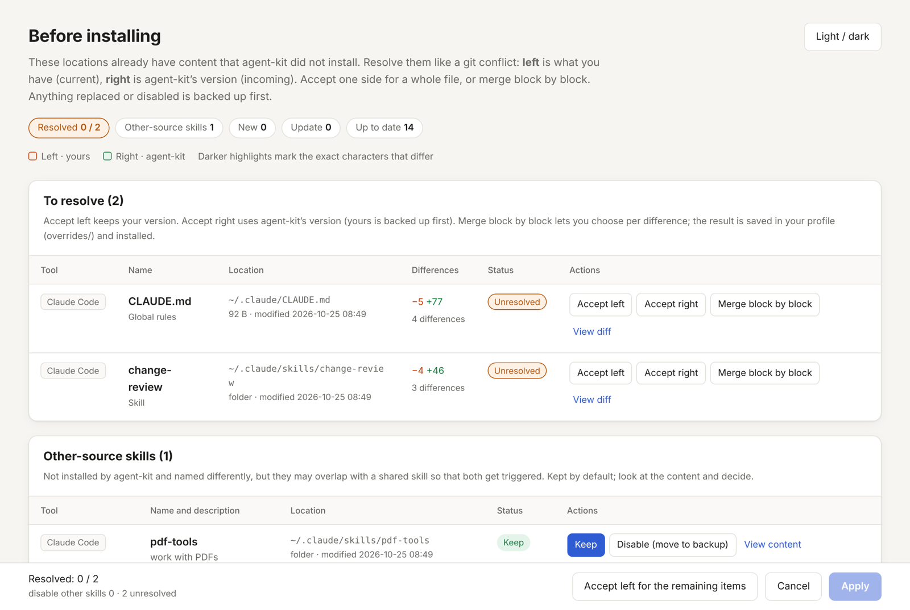
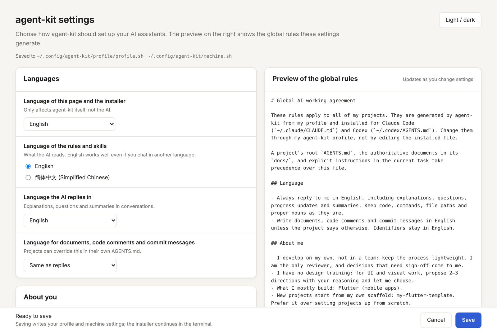
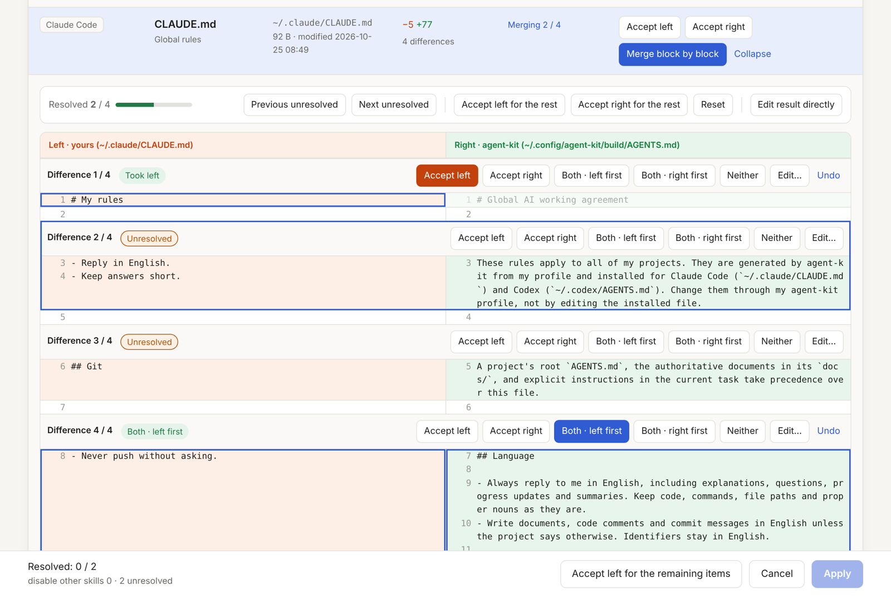

# agent-kit

**English** · [简体中文](README.zh-CN.md)

One set of rules and skills for AI coding assistants, shared across all your computers and projects. agent-kit generates your global rules and skills from a short list of preferences, installs them for **Claude Code** and **Codex**, and keeps them in step on every machine.

- **Customizable at install time:** pick the language the AI replies in, the language of the rules themselves, how you work (solo or team, design experience, how much planning), commit style, stacks, skills and tools.
- **Your settings stay yours:** preferences live in a *profile* you can keep in your own private Git repository. Paths that only make sense on one computer stay on that computer.
- **Safe on machines that already have rules:** anything agent-kit didn't install is treated like a git conflict. You resolve it in a local web page: accept left, accept right, or merge block by block. Everything replaced is backed up first.
- **No dependencies:** bash (3.2 or newer, so the macOS default works) and, for the web pages, python3. Nothing to install from a package manager.



## Contents

- [Quick start](#quick-start)
- [How it fits together](#how-it-fits-together)
- [Settings](#settings)
- [Sync your profile between computers](#sync-your-profile-between-computers)
- [Existing rules and skills: conflicts](#existing-rules-and-skills-conflicts)
- [Projects](#projects)
- [What's included](#whats-included)
- [Commands](#commands)
- [Files and locations](#files-and-locations)
- [Customizing further](#customizing-further)
- [Uninstall](#uninstall)
- [FAQ](#faq)
- [License](#license)

## Quick start

```bash
git clone https://github.com/YuY-QK/agent-kit.git ~/agent-kit
~/agent-kit/scripts/install.sh
```

The first run asks whether to answer the settings questions in a web page or in the terminal, then shows what it will install. Re-run `install.sh` whenever you pull a new version of agent-kit or change your settings; it only touches what changed.

Already have a profile in a private repository? Install from it directly:

```bash
~/agent-kit/scripts/install.sh --profile git@github.com:you/agent-profile.git
```

To see the plan without changing anything: `scripts/install.sh --dry-run`.

## How it fits together

There are three layers, from most general to most specific:

| Layer | What it is | Where it comes from |
|---|---|---|
| **Global rules** | How the assistant works with you in every project: language, planning, engineering habits, verification, git | Assembled from `rules/` using your profile, installed as `~/.claude/CLAUDE.md` and `~/.codex/AGENTS.md` |
| **Shared skills** | Reusable workflows (planning a new app, reviewing changes, testing…) plus stack skills (Flutter, single-file web) | `skills/` and `stacks/<stack>/skills/`, installed into `~/.claude/skills/` and `~/.agents/skills/` |
| **Project layer** | What is specific to one project: commands, architecture, conventions | Each project's own `AGENTS.md` (and a `CLAUDE.md` that points to it), started from `templates/project/` |

And three places for your data:

| | Contains | Shared? |
|---|---|---|
| **agent-kit** (this repository) | The rule fragments, skills, templates and scripts | Public; the same for everyone |
| **Profile** (`~/.config/agent-kit/profile/`) | Your preferences, extra rules, personal skills and merge results | Yours; sync it through a private Git repository |
| **Machine settings** (`~/.config/agent-kit/machine.sh`) | Project folders on this computer, profile location | Never synced |

`install.sh` builds the final files into `~/.config/agent-kit/build/` and links them into place, so a single `git pull` + `install.sh` updates everything.

## Settings

Run `scripts/configure.sh --web` (or `scripts/install.sh --configure`) to change your settings in a web page. The preview on the right shows the global rules your choices generate, as you change them. `scripts/configure.sh` asks the same questions in the terminal; press Enter to keep the current answer.



| Setting | Choices | Default | What it changes |
|---|---|---|---|
| `UI_LANG` | `en`, `zh-CN` | your system language | Language of the installer and the web pages |
| `CONTENT_LANG` | `en`, `zh-CN` | `en` | Language the rules and skills are written in. English works well even if you chat in another language |
| `REPLY_LANG` | `en`, `zh-CN`, `zh-TW`, `ja`, `ko`, `es`, `fr`, `de`, or any language name | `UI_LANG` | Language the assistant replies in |
| `DOCS_LANG` | `reply` or any of the above | `reply` | Language of documents, code comments and commit messages |
| `WORK_MODE` | `solo`, `team` | `solo` | Solo keeps the process light and treats you as the only reviewer; team adds reviewers, shared conventions and hand-offs |
| `DESIGN` | `none`, `some` | `none` | With `none`, the assistant proposes 2–3 UI directions with reasoning instead of asking you for a design |
| `PLANNING` | `full`, `light`, `off` | `full` | `full`: idea brief → PRD → prototype → technical design → plan before building. `light`: a short plan. `off`: no planning rule |
| `COMMITS` | `conventional`, `free` | `conventional` | Conventional Commits, or just clear descriptive messages |
| `SCAFFOLD` | free text | empty | Your own project template, if you have one; the assistant prefers it over starting from scratch |
| `STACKS` | `flutter`, `web` | all | Stack skills to install |
| `SKILLS` | `all` or a list of names | `all` | Shared skills to install |
| `TOOLS` | `claude`, `codex` | both | Which assistants to install for |
| `PROJECT_DIRS` | folders, separated by `:` | empty | Machine setting: where `check-projects.sh` looks for projects |

The extra-rules box on the settings page writes to `rules/custom.md` in your profile; it is added to the end of the global rules.

The settings are saved as two small shell-style files; see [`examples/profile.sh`](examples/profile.sh) and [`examples/machine.sh`](examples/machine.sh). They are read as plain `KEY="value"` lines and never executed, so it is safe to edit them by hand.

## Sync your profile between computers

1. Create an **empty private** repository, for example `agent-profile`, on GitHub (or anywhere Git can reach).
2. On the computer where you set agent-kit up:

   ```bash
   ~/agent-kit/scripts/sync-profile.sh init git@github.com:you/agent-profile.git
   ```

3. On every other computer:

   ```bash
   git clone https://github.com/YuY-QK/agent-kit.git ~/agent-kit
   ~/agent-kit/scripts/install.sh --profile git@github.com:you/agent-profile.git
   ```

   The machine settings (project folders) are asked for separately on each computer.

Day to day:

```bash
scripts/sync-profile.sh push    # after changing settings, merging conflicts or editing your rules
scripts/sync-profile.sh pull    # on another computer, then run install.sh
scripts/sync-profile.sh status  # where the profile is and whether it has unpushed changes
```

`install.sh` reminds you when the profile has changes that aren't pushed yet. The profile never contains machine paths, so it is the same on every computer.

You can also keep the profile somewhere else, such as a folder that is already synced: `install.sh --profile ~/Dropbox/agent-profile`.

## Existing rules and skills: conflicts

Before installing, `install.sh` checks every target location and prints a plan:

| Status | Meaning | What happens |
|---|---|---|
| new | Nothing there yet | Installed |
| update | Installed by agent-kit before, or the same content | Replaced with the new version |
| up to date | Already the current version | Nothing |
| conflict | Content agent-kit didn't install (your own `CLAUDE.md`, a skill with the same name…) | You decide |
| outdated override | You merged this file earlier, and agent-kit's version has changed since | You decide whether to keep your merge |
| other source | A skill agent-kit didn't install and that has a different name, but may overlap | Kept unless you disable it |

When something needs a decision, a local web page opens. It works like resolving a git conflict: **left** is what you have, **right** is agent-kit's version.

- **Accept left** keeps yours; agent-kit doesn't install that item.
- **Accept right** installs agent-kit's version; yours is backed up first.
- **Merge block by block** walks through each difference: take left, right, both in either order, neither, or edit the text yourself. You can also edit the whole result directly.



A merge result is saved in your profile under `overrides/` and installed in place of the generated file, so it follows you to other computers. When agent-kit's version of that file changes later, it shows up as an *outdated override* and you can review it against the new version.

Other ways to decide:

- `install.sh --no-web` asks in the terminal instead (`r` replace, `k` keep, `d` show diff).
- `install.sh --yes` backs up and replaces all conflicts and keeps your overrides, without asking.
- In a non-interactive run (no terminal), existing content is always kept.

Backups go to `~/.config/agent-kit/backups/<date-time>/`, mirroring the original paths.

The page runs only on `127.0.0.1`, needs a one-time token in its address, and closes after 30 minutes. It doesn't load anything from the internet.

## Projects

The global rules say how to work; each project's `AGENTS.md` says what is specific to that project. Codex reads `AGENTS.md` directly; Claude Code reads `CLAUDE.md`, so the template's `CLAUDE.md` contains only `@AGENTS.md` and both tools read the same rules.

```bash
scripts/new-project.sh ~/Code/my-app "My App"              # adds AGENTS.md, CLAUDE.md, docs/AI_RULES.md
scripts/new-project.sh ~/Code/my-app "My App" --lang zh-CN # template in another language
scripts/check-projects.sh                                  # checks every project under PROJECT_DIRS
scripts/check-projects.sh ~/Code/my-app                    # or specific projects
```

`new-project.sh` never overwrites existing files. Fill in the parts marked `{{...}}` afterwards. `check-projects.sh` only reports; it warns about a missing `AGENTS.md` or `CLAUDE.md`, and about project skills with the same name as a shared skill (both would load).

## What's included

Shared skills:

| Skill | Use it to |
|---|---|
| `idea-to-plan` | Turn a new app or product idea into an idea brief, PRD, prototype, technical design and development plan, then wire it into a project |
| `product-change` | Design or review requirements, scope, business rules, flows and acceptance criteria; control requirement changes |
| `ui-experience` | Design or review screens, flows, component states, visual hierarchy, motion, responsiveness, localisation and accessibility |
| `architecture-change` | Design or review cross-module architecture, data, networking, integrations, permissions and security boundaries |
| `change-review` | Review code, test or documentation changes for correctness, data safety, architecture, privacy and regressions |
| `quality-testing` | Design, write or review tests and regression scope |

Stack skills:

| Stack | Skill | Use it to |
|---|---|---|
| `flutter` | `flutter-development` | Implement or refactor Flutter/Dart code (layering, Riverpod, local-first, localisation, FVM) |
| `web` | `single-file-web` | Build single-file web pages that open directly in a browser: demos, clickable prototypes, small tools |

Every skill has an English `SKILL.md` and a Chinese `SKILL.zh-CN.md`; the installer picks one according to `CONTENT_LANG`.

## Commands

| Command | Does |
|---|---|
| `scripts/install.sh` | Install or update. Options: `--profile SOURCE`, `--configure`, `--dry-run`, `--review` (open the page even without conflicts), `--no-web`, `--yes`, `--copy` (copy instead of symlink), `--uninstall` |
| `scripts/configure.sh` | Change settings in the terminal; `--web` for the web page; `--missing` to answer only new questions |
| `scripts/sync-profile.sh` | `status`, `init URL`, `clone URL`, `pull`, `push [message]` |
| `scripts/new-project.sh` | Add the project template to a project |
| `scripts/check-projects.sh` | Check projects against the project-layer conventions |
| `scripts/build.sh` | Build into `~/.config/agent-kit/build/`; `--rules` prints the generated global rules |

Run any script with `--help` for details.

## Files and locations

```
~/.config/agent-kit/
├── machine.sh             machine settings (this computer only)
├── profile/               your profile (sync it in a private repository)
│   ├── profile.sh         preferences
│   ├── rules/*.md         extra rules, appended in file-name order
│   ├── skills/<name>/     your own skills, installed next to the shared ones
│   └── overrides/         merge results from the conflict page
├── build/                 generated files; the installed links point here
├── state/                 what was copied (for --copy)
└── backups/<date-time>/   anything replaced or disabled
```

| Tool | Global rules | Skills |
|---|---|---|
| Claude Code | `~/.claude/CLAUDE.md` | `~/.claude/skills/` |
| Codex | `~/.codex/AGENTS.md` | `~/.agents/skills/` |

Set `AGENT_KIT_HOME` to use a folder other than `~/.config/agent-kit`, or `AGENT_KIT_PROFILE` to point at a profile folder for one run.

## Customizing further

- **Add your own rules:** put Markdown files in `profile/rules/` (or use the extra-rules box on the settings page).
- **Add your own skills:** put them in `profile/skills/<name>/SKILL.md`. A personal skill with the same name as a shared one replaces it.
- **Change a shared skill or the generated rules for yourself:** edit the merge result in `profile/overrides/`, or resolve it on the conflict page.
- **Change agent-kit for everyone:** fork it. Rules are assembled from small fragments in `rules/<lang>/` in the order given by `rules/manifest`; `${KEY}` picks a fragment by a setting and `?KEY` includes a line only when the setting is not empty. Skills are plain folders under `skills/` and `stacks/<stack>/skills/`.
- **Add a stack:** create `stacks/<name>/skills/<skill>/SKILL.md` and a `STACK_<name>` label in `rules/<lang>/labels.sh`.

## Uninstall

```bash
scripts/install.sh --uninstall
```

This removes only what agent-kit installed (its links, and copies it recorded). Your profile, machine settings and backups stay in `~/.config/agent-kit/`; delete that folder too if you want everything gone.

## FAQ

**Do I need python3?** Only for the web pages. Without it, everything works in the terminal. macOS includes python3 with the Command Line Tools.

**Symlinks or copies?** Symlinks by default, so `git pull` + `install.sh` is all it takes to update. Use `--copy` where symlinks are inconvenient (for example with some file-sync tools). Copies that you edit by hand are detected and treated as conflicts.

**Will this overwrite my existing `CLAUDE.md`?** No. Anything agent-kit didn't install is a conflict; you choose, and anything replaced is backed up.

**Does Claude Code read `AGENTS.md`?** Not on its own. That's why the global rules are installed as `CLAUDE.md` for Claude Code and as `AGENTS.md` for Codex, and why each project's `CLAUDE.md` contains `@AGENTS.md`.

**I chat in another language. Should the rules be in that language too?** Not necessarily. Set `REPLY_LANG` to your language and leave `CONTENT_LANG` as English; the assistant follows English rules just as well and replies in your language.

## License

[MIT](LICENSE)
