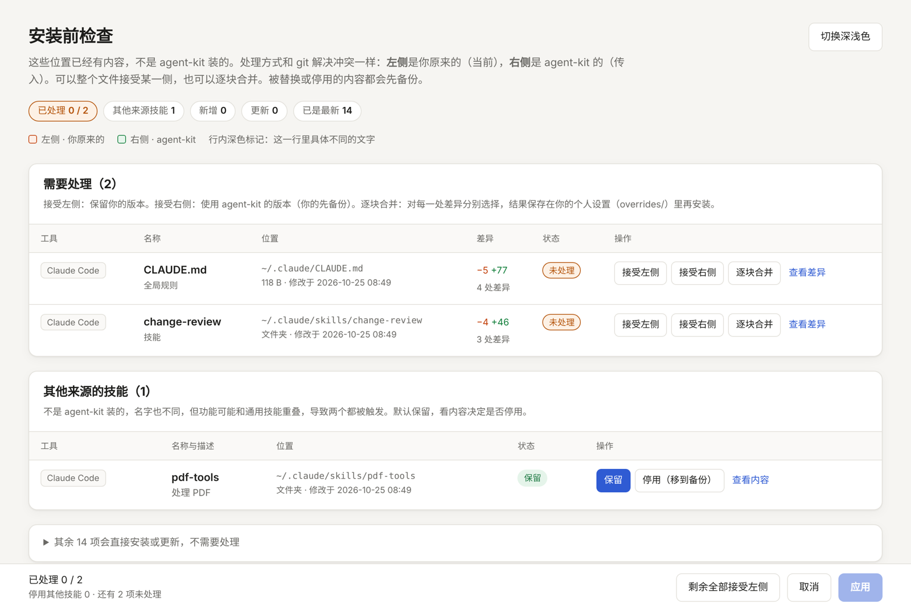
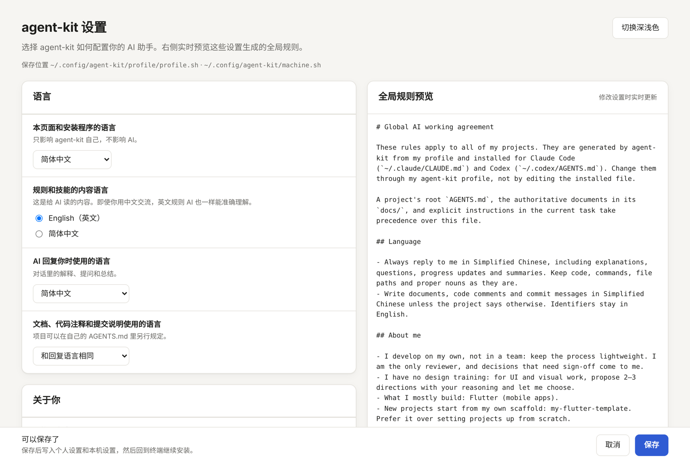
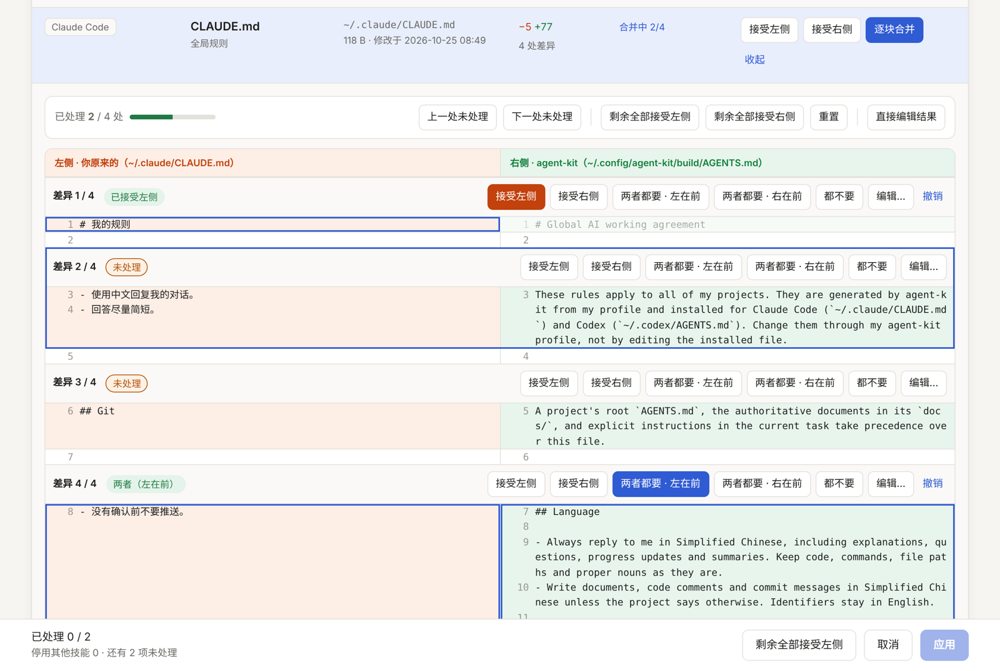

# agent-kit

[English](README.md) · **简体中文**

给 AI 编程助手用的一套规则和技能，在你所有的电脑和项目之间共用。agent-kit 根据一份简短的个人偏好生成全局规则和技能，安装到 **Claude Code** 和 **Codex**，并让每台电脑保持一致。

- **安装时可定制**：AI 用什么语言回复你、规则本身用什么语言写、你的工作方式（个人还是团队、有没有设计经验、需要多少前期规划）、提交说明风格、技术栈、技能和工具，都可以选。
- **个人设置归你自己**：偏好保存在「个人设置」（profile）里，可以放进你自己的私有 Git 仓库。只对某台电脑有意义的路径留在那台电脑上。
- **已有规则的电脑也能放心装**：不是 agent-kit 装的内容一律当作 git 冲突处理，在本地网页里解决：接受左侧、接受右侧，或者逐块合并。被替换的内容都会先备份。
- **没有依赖**：bash（3.2 及以上，macOS 自带的就行）；网页需要 python3。不需要通过包管理器装任何东西。



## 目录

- [快速开始](#快速开始)
- [整体结构](#整体结构)
- [设置项](#设置项)
- [在多台电脑间同步个人设置](#在多台电脑间同步个人设置)
- [已有的规则和技能：冲突处理](#已有的规则和技能冲突处理)
- [项目](#项目)
- [包含的技能](#包含的技能)
- [命令](#命令)
- [文件和位置](#文件和位置)
- [进一步定制](#进一步定制)
- [卸载](#卸载)
- [常见问题](#常见问题)
- [许可证](#许可证)

## 快速开始

```bash
git clone https://github.com/YuY-QK/agent-kit.git ~/agent-kit
~/agent-kit/scripts/install.sh
```

第一次运行会问你在网页里还是在终端里回答设置问题，然后列出将要安装的内容。以后拉取了新版本或者改了设置，再运行一次 `install.sh` 就行，它只处理有变化的部分。

已经有放在私有仓库里的个人设置？直接从它安装：

```bash
~/agent-kit/scripts/install.sh --profile git@github.com:you/agent-profile.git
```

只想看安装计划、什么都不改：`scripts/install.sh --dry-run`。

## 整体结构

分三层，从通用到具体：

| 层 | 是什么 | 从哪来 |
|---|---|---|
| **全局规则** | 助手在所有项目里怎么和你协作：语言、规划、工程习惯、验证、git | 用你的个人设置从 `rules/` 拼装，安装为 `~/.claude/CLAUDE.md` 和 `~/.codex/AGENTS.md` |
| **通用技能** | 可复用的工作流程（规划新应用、审查改动、测试等），以及技术栈技能（Flutter、单文件网页） | `skills/` 和 `stacks/<技术栈>/skills/`，安装到 `~/.claude/skills/` 和 `~/.agents/skills/` |
| **项目层** | 某个项目特有的内容：命令、架构、约定 | 每个项目自己的 `AGENTS.md`（以及指向它的 `CLAUDE.md`），用 `templates/project/` 起步 |

你的数据放在三个地方：

| | 内容 | 是否共享 |
|---|---|---|
| **agent-kit**（本仓库） | 规则片段、技能、模板和脚本 | 公开，所有人一样 |
| **个人设置**（`~/.config/agent-kit/profile/`） | 你的偏好、额外规则、个人技能和合并结果 | 属于你自己，通过私有 Git 仓库同步 |
| **本机设置**（`~/.config/agent-kit/machine.sh`） | 这台电脑上的项目目录、个人设置的位置 | 从不同步 |

`install.sh` 把最终文件生成到 `~/.config/agent-kit/build/`，再链接到各个位置，所以 `git pull` 加 `install.sh` 就能更新全部内容。

## 设置项

运行 `scripts/configure.sh --web`（或 `scripts/install.sh --configure`）在网页里修改设置。右侧会随着你的修改实时预览生成的全局规则。`scripts/configure.sh` 在终端里问同样的问题，直接回车保留当前值。



| 设置 | 可选值 | 默认值 | 影响什么 |
|---|---|---|---|
| `UI_LANG` | `en`、`zh-CN` | 系统语言 | 安装程序和网页的语言 |
| `CONTENT_LANG` | `en`、`zh-CN` | `en` | 规则和技能用什么语言写。即使你用中文交流，英文规则 AI 也一样能准确理解 |
| `REPLY_LANG` | `en`、`zh-CN`、`zh-TW`、`ja`、`ko`、`es`、`fr`、`de`，或任意语言名称 | 同 `UI_LANG` | AI 回复你时使用的语言 |
| `DOCS_LANG` | `reply` 或上面任意一种 | `reply` | 文档、代码注释和提交说明的语言 |
| `WORK_MODE` | `solo`、`team` | `solo` | 个人：流程保持轻量，你是唯一的审核人；团队：加入评审、共同约定和交接 |
| `DESIGN` | `none`、`some` | `none` | 选 `none` 时，助手会给出 2–3 个界面方向并说明理由，而不是让你提供设计 |
| `PLANNING` | `full`、`light`、`off` | `full` | `full`：动手前先做想法简报 → PRD → 原型 → 技术设计 → 开发计划；`light`：简短计划；`off`：不加规划规则 |
| `COMMITS` | `conventional`、`free` | `conventional` | 使用 Conventional Commits，或者只要求清楚的描述 |
| `SCAFFOLD` | 自由填写 | 空 | 你自己的项目模板（如果有）；助手会优先用它，而不是从零搭建 |
| `STACKS` | `flutter`、`web` | 全部 | 要安装的技术栈技能 |
| `SKILLS` | `all` 或技能名列表 | `all` | 要安装的通用技能 |
| `TOOLS` | `claude`、`codex` | 两个都装 | 给哪些助手安装 |
| `PROJECT_DIRS` | 目录，用 `:` 分隔 | 空 | 本机设置：`check-projects.sh` 去哪里找项目 |

设置页面上的「额外规则」会写入个人设置里的 `rules/custom.md`，追加在全局规则末尾。

设置保存为两个很小的 shell 风格文件，格式见 [`examples/profile.sh`](examples/profile.sh) 和 [`examples/machine.sh`](examples/machine.sh)。它们只按 `KEY="value"` 逐行读取，不会被执行，手动编辑也是安全的。

## 在多台电脑间同步个人设置

1. 在 GitHub（或任何 Git 能访问的地方）创建一个**空的私有**仓库，例如 `agent-profile`。
2. 在已经配置好 agent-kit 的电脑上：

   ```bash
   ~/agent-kit/scripts/sync-profile.sh init git@github.com:you/agent-profile.git
   ```

3. 在其他每台电脑上：

   ```bash
   git clone https://github.com/YuY-QK/agent-kit.git ~/agent-kit
   ~/agent-kit/scripts/install.sh --profile git@github.com:you/agent-profile.git
   ```

   本机设置（项目目录）会在每台电脑上单独询问。

日常使用：

```bash
scripts/sync-profile.sh push    # 改了设置、合并了冲突或编辑了规则之后
scripts/sync-profile.sh pull    # 在另一台电脑上拉取，然后运行 install.sh
scripts/sync-profile.sh status  # 个人设置在哪、有没有没推送的改动
```

个人设置有未推送的改动时，`install.sh` 会提醒你。个人设置里不包含任何本机路径，所以每台电脑上都一样。

也可以把个人设置放在别的地方，比如已经在同步的文件夹：`install.sh --profile ~/Dropbox/agent-profile`。

## 已有的规则和技能：冲突处理

安装前，`install.sh` 会检查每个目标位置并列出计划：

| 状态 | 含义 | 处理方式 |
|---|---|---|
| 新增 | 那里还没有内容 | 直接安装 |
| 更新 | 之前由 agent-kit 安装，或内容相同 | 替换为新版本 |
| 已是最新 | 已经是当前版本 | 不处理 |
| 冲突 | 不是 agent-kit 装的内容（你自己的 `CLAUDE.md`、同名技能等） | 由你决定 |
| 覆盖已过期 | 你之前合并过这个文件，之后 agent-kit 的版本又变了 | 由你决定是否保留之前的合并 |
| 其他来源 | 不是 agent-kit 装的、名字也不同，但功能可能重叠的技能 | 默认保留，可以停用 |

需要你决定时会打开一个本地网页，操作方式和解决 git 冲突一样：**左侧**是你原来的，**右侧**是 agent-kit 的版本。

- **接受左侧**：保留你的，agent-kit 不安装这一项。
- **接受右侧**：安装 agent-kit 的版本，你的先备份。
- **逐块合并**：逐处处理每个差异：取左侧、取右侧、两边都要（任意顺序）、都不要，或者自己编辑文字；也可以直接编辑整个合并结果。



合并结果保存在个人设置的 `overrides/` 里，代替生成的文件安装，所以会跟着你到其他电脑。之后 agent-kit 的这个文件有了变化，会显示为「覆盖已过期」，你可以对照新版本重新检查。

其他决定方式：

- `install.sh --no-web`：改为在终端里询问（`r` 替换，`k` 保留，`d` 查看差异）。
- `install.sh --yes`：不询问，备份并替换所有冲突，保留你的覆盖。
- 非交互运行（没有终端）时，已有内容一律保留。

备份放在 `~/.config/agent-kit/backups/<日期时间>/`，保持原来的路径结构。

网页只运行在 `127.0.0.1`，地址里需要一次性令牌，30 分钟后自动关闭，不从网络加载任何内容。

## 项目

全局规则说明怎么工作，每个项目的 `AGENTS.md` 说明这个项目特有的东西。Codex 直接读 `AGENTS.md`；Claude Code 读 `CLAUDE.md`，所以模板里的 `CLAUDE.md` 只有一行 `@AGENTS.md`，两个工具读的是同一份规则。

```bash
scripts/new-project.sh ~/Code/my-app "My App"              # 添加 AGENTS.md、CLAUDE.md、docs/AI_RULES.md
scripts/new-project.sh ~/Code/my-app "我的应用" --lang zh-CN # 使用中文模板
scripts/check-projects.sh                                  # 检查 PROJECT_DIRS 下的所有项目
scripts/check-projects.sh ~/Code/my-app                    # 或者只检查指定项目
```

`new-project.sh` 不会覆盖已有文件，之后把标着 `{{...}}` 的部分填好。`check-projects.sh` 只报告、不修改：缺少 `AGENTS.md` 或 `CLAUDE.md` 会提示，项目里有和通用技能同名的技能也会提示（两个都会被加载）。

## 包含的技能

通用技能：

| 技能 | 用途 |
|---|---|
| `idea-to-plan` | 把新的应用或产品想法逐步完善成想法简报、PRD、原型、技术设计和开发计划，再接入项目 |
| `product-change` | 设计或审查需求、范围、业务规则、流程和验收标准，控制需求变更 |
| `ui-experience` | 设计或审查界面、流程、组件状态、视觉层级、动效、适配、本地化和无障碍 |
| `architecture-change` | 设计或审查跨模块架构、数据、网络、集成、权限和安全边界 |
| `change-review` | 审查代码、测试或文档改动的正确性、数据安全、架构、隐私和回归问题 |
| `quality-testing` | 设计、编写或审查测试和回归范围 |

技术栈技能：

| 技术栈 | 技能 | 用途 |
|---|---|---|
| `flutter` | `flutter-development` | 按分层、Riverpod、本地优先、本地化和 FVM 规则实现或重构 Flutter/Dart 代码 |
| `web` | `single-file-web` | 制作无需构建、直接用浏览器打开的单文件网页：演示、可点击原型、小工具 |

每个技能都有英文 `SKILL.md` 和中文 `SKILL.zh-CN.md`，安装时按 `CONTENT_LANG` 选用。

## 命令

| 命令 | 作用 |
|---|---|
| `scripts/install.sh` | 安装或更新。选项：`--profile 来源`、`--configure`、`--dry-run`、`--review`（没有冲突也打开网页）、`--no-web`、`--yes`、`--copy`（复制而不是链接）、`--uninstall` |
| `scripts/configure.sh` | 在终端修改设置；`--web` 用网页；`--missing` 只回答新增的问题 |
| `scripts/sync-profile.sh` | `status`、`init 地址`、`clone 地址`、`pull`、`push [说明]` |
| `scripts/new-project.sh` | 给项目添加项目模板 |
| `scripts/check-projects.sh` | 按项目层约定检查项目 |
| `scripts/build.sh` | 生成到 `~/.config/agent-kit/build/`；`--rules` 输出生成的全局规则 |

任意脚本加 `--help` 查看详细说明。

## 文件和位置

```
~/.config/agent-kit/
├── machine.sh             本机设置（只属于这台电脑）
├── profile/               个人设置（用私有仓库同步）
│   ├── profile.sh         偏好
│   ├── rules/*.md         额外规则，按文件名顺序追加
│   ├── skills/<名称>/     你自己的技能，和通用技能一起安装
│   └── overrides/         冲突页面里的合并结果
├── build/                 生成的文件，安装的链接指向这里
├── state/                 复制安装的记录（--copy）
└── backups/<日期时间>/    被替换或停用的内容
```

| 工具 | 全局规则 | 技能 |
|---|---|---|
| Claude Code | `~/.claude/CLAUDE.md` | `~/.claude/skills/` |
| Codex | `~/.codex/AGENTS.md` | `~/.agents/skills/` |

设置 `AGENT_KIT_HOME` 可以改用 `~/.config/agent-kit` 以外的目录；`AGENT_KIT_PROFILE` 可以在单次运行时指定个人设置目录。

## 进一步定制

- **添加自己的规则**：把 Markdown 文件放进 `profile/rules/`（或者用设置页面上的「额外规则」）。
- **添加自己的技能**：放在 `profile/skills/<名称>/SKILL.md`。和通用技能同名的个人技能会替换通用技能。
- **只为自己修改通用技能或生成的规则**：编辑 `profile/overrides/` 里的合并结果，或者在冲突页面里处理。
- **为所有人修改 agent-kit**：fork 本仓库。规则由 `rules/<语言>/` 下的小片段按 `rules/manifest` 的顺序拼装：`${KEY}` 按设置选择片段，`?KEY` 表示设置不为空时才包含这一行。技能就是 `skills/` 和 `stacks/<技术栈>/skills/` 下的普通文件夹。
- **添加技术栈**：创建 `stacks/<名称>/skills/<技能>/SKILL.md`，并在 `rules/<语言>/labels.sh` 里加上 `STACK_<名称>` 标签。

## 卸载

```bash
scripts/install.sh --uninstall
```

只移除 agent-kit 安装的内容（它的链接，以及它记录过的复制文件）。个人设置、本机设置和备份仍然留在 `~/.config/agent-kit/`，想全部清除的话把这个目录也删掉。

## 常见问题

**一定要 python3 吗？** 只有网页需要。没有 python3 时，所有功能都可以在终端里完成。macOS 安装命令行工具后自带 python3。

**链接还是复制？** 默认用符号链接，`git pull` 加 `install.sh` 就能更新。不方便用链接的场景（例如某些文件同步工具）可以用 `--copy`。手动改过的复制文件会被识别出来，当作冲突处理。

**会覆盖我现有的 `CLAUDE.md` 吗？** 不会。不是 agent-kit 装的内容都算冲突，由你选择，被替换的都会备份。

**Claude Code 会读 `AGENTS.md` 吗？** 不会自动读。所以全局规则给 Claude Code 装成 `CLAUDE.md`、给 Codex 装成 `AGENTS.md`，每个项目的 `CLAUDE.md` 里写 `@AGENTS.md`。

**我用中文交流，规则也要用中文吗？** 不一定。把 `REPLY_LANG` 设成中文，`CONTENT_LANG` 保持英文即可；助手照样能准确遵守英文规则，并用中文回复你。

## 许可证

[MIT](LICENSE)
